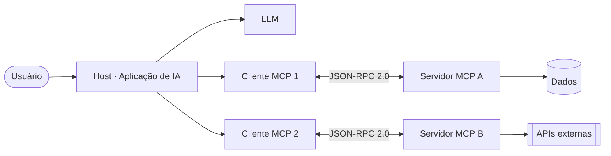

<div align="center">

# 🔬 Grupo 2 · MPES CESAR 26

### Pesquisa Aplicada em Engenharia de Software · Model Context Protocol (MCP)

*Integração padronizada entre modelos de linguagem, ferramentas e fontes de dados*


</div>

---

## 📄 Resumo

Este repositório documenta a pesquisa aplicada conduzida pelo **Grupo 2** da turma **MPES 2026.2** (Mestrado Profissional em Engenharia de Software, CESAR School) no âmbito do **Projeto 1 — MCP**. A investigação aborda o **Model Context Protocol**, um protocolo aberto que padroniza a forma como aplicações baseadas em modelos de linguagem de grande porte (*Large Language Models*, LLMs) acessam ferramentas, dados e fluxos de trabalho externos. O objetivo é projetar, implementar e avaliar soluções de referência, registrando decisões arquiteturais, procedimentos experimentais e resultados de forma reprodutível.

**Palavras-chave:** Engenharia de Software · Model Context Protocol · LLMs · Agentes de IA · Interoperabilidade · Arquitetura de Software · Reprodutibilidade.

---

## 📑 Sumário

1. [Contexto e motivação](#1--contexto-e-motivação)
2. [Problema e questões de pesquisa](#2--problema-e-questões-de-pesquisa)
3. [Objetivos](#3--objetivos)
4. [Fundamentação teórica](#4--fundamentação-teórica)
5. [Arquitetura de referência](#5--arquitetura-de-referência)
6. [Metodologia](#6--metodologia)
7. [Organização do repositório](#7--organização-do-repositório)
8. [Reprodutibilidade e boas práticas](#8--reprodutibilidade-e-boas-práticas)
9. [Equipe](#9--equipe)
10. [Como citar](#10--como-citar)
11. [Referências](#11--referências)

---

## 1. 🧭 Contexto e motivação

A adoção de LLMs em produtos de software criou uma demanda recorrente: conectar modelos a sistemas corporativos, bases de dados e APIs. Sem um padrão comum, cada integração tende a ser **ad hoc**, gerando acoplamento, duplicação de esforço e dificuldade de governança. Protocolos abertos de contexto buscam reduzir esse custo, separando o *host* de IA das capacidades expostas por servidores independentes.

Do ponto de vista da Engenharia de Software, o tema levanta questões de **arquitetura**, **qualidade**, **segurança** e **evolução** de sistemas que combinam componentes determinísticos e não determinísticos.

## 2. ❓ Problema e questões de pesquisa

> **Nota:** as questões abaixo constituem uma versão inicial e devem ser refinadas pelo grupo junto à orientação.

| Código | Questão de pesquisa |
|:------:|---------------------|
| **QP1** | Como projetar servidores MCP coesos, reutilizáveis e testáveis para diferentes fontes de dados e ferramentas? |
| **QP2** | Quais atributos de qualidade (desempenho, segurança, observabilidade, manutenibilidade) são mais críticos em soluções baseadas em MCP? |
| **QP3** | Que práticas de engenharia reduzem o esforço de integração entre LLMs e sistemas existentes? |

## 3. 🎯 Objetivos

**Objetivo geral:** investigar e demonstrar, de forma sistemática e reprodutível, o uso do MCP como camada de integração entre aplicações de IA e sistemas externos.

**Objetivos específicos**

- Revisar a literatura e a especificação oficial do protocolo.
- Propor uma arquitetura de referência e implementar um ou mais servidores MCP.
- Definir critérios e métricas de avaliação alinhados às questões de pesquisa.
- Documentar decisões, limitações e lições aprendidas para replicação.

## 4. 📚 Fundamentação teórica

O MCP adota uma arquitetura **cliente–servidor** sobre mensagens **JSON-RPC 2.0** [4]. Um *host* (aplicação de IA) mantém clientes que se conectam a servidores, os quais expõem capacidades por meio de três primitivas principais:

| Primitiva | Descrição | Controle típico |
|-----------|-----------|-----------------|
| **Tools** | Funções executáveis que o modelo pode invocar | Modelo |
| **Resources** | Dados e contexto disponibilizados para leitura | Aplicação |
| **Prompts** | Modelos de interação reutilizáveis | Usuário |

A comunicação ocorre por meio de transportes como **stdio** (processos locais) e **HTTP** com respostas em fluxo (servidores remotos). A especificação oficial é a fonte normativa e deve ser consultada para a versão vigente [1].

## 5. 🏗️ Arquitetura de referência



A figura apresenta a visão conceitual adotada como ponto de partida; será detalhada em **ADRs** (*Architecture Decision Records*) conforme o projeto evoluir.

## 6. 🧪 Metodologia

A pesquisa adota, como proposta inicial, uma abordagem de **Design Science Research (DSR)** [2], em ciclos iterativos de projeto e avaliação de artefatos.

| Etapa | Atividade | Produto |
|:-----:|-----------|---------|
| 1 | Identificação do problema e revisão da literatura | Protocolo de revisão, síntese |
| 2 | Definição de requisitos e critérios de avaliação | Requisitos, métricas |
| 3 | Projeto e implementação do artefato | Código, ADRs |
| 4 | Avaliação (testes, experimentos, análise qualitativa) [3] | Dados, relatório |
| 5 | Comunicação e consolidação | Documentação, artigo/relatório final |

## 7. 🗂️ Organização do repositório

Estrutura-alvo sugerida para os repositórios de código do grupo:

```text
.
├── docs/            # relatórios, ADRs, protocolos e diagramas
├── src/             # implementação (servidores e clientes MCP)
├── tests/           # testes automatizados
├── experiments/     # roteiros, dados e resultados de avaliação
├── CITATION.cff     # metadados para citação
└── README.md
```

## 8. ♻️ Reprodutibilidade e boas práticas

- **Versionamento:** Git com fluxo por ramos e *pull requests* revisados por pares.
- **Mensagens de commit:** convenção [Conventional Commits](https://www.conventionalcommits.org/pt-br/).
- **Decisões:** registro em ADRs versionados junto ao código.
- **Ambientes:** dependências fixadas e instruções de execução documentadas.
- **Dados e resultados:** scripts e parâmetros publicados para permitir replicação.

## 9. 👥 Equipe

**Equipe 2 · Projeto 1 — MCP**

| # | Pesquisador(a) |
|:-:|----------------|
| 1 | Cleyber Gomes da Silva · [@cleybersilva](https://github.com/cleybersilva) |
| 2 | Daniel Cavalcante Macedo |
| 3 | Eduardo Cavalcanti de Andrade Filho |
| 4 | Estela de Lacerda Oliveira |
| 5 | Lucas Rodrigues Albino |
| 6 | Policarpo de Freitas |

📅 Calendário e equipes da turma: [mpes-calendario](https://cleybersilva.github.io/mpes-calendario/)

## 10. 📌 Como citar

```bibtex
@misc{grupo2_mpes_2026,
  author       = {Silva, Cleyber Gomes da and Macedo, Daniel Cavalcante and
                  Andrade Filho, Eduardo Cavalcanti de and Oliveira, Estela de Lacerda and
                  Albino, Lucas Rodrigues and Freitas, Policarpo de},
  title        = {Grupo 2 · MPES CESAR 26: Pesquisa aplicada sobre o Model Context Protocol},
  year         = {2026},
  institution  = {CESAR School},
  howpublished = {\url{https://github.com/grupo2-mpes-cesar-26}}
}
```

## 11. 📖 Referências

1. **Model Context Protocol.** *Specification.* Disponível em: <https://modelcontextprotocol.io>.
2. HEVNER, A. R.; MARCH, S. T.; PARK, J.; RAM, S. Design Science in Information Systems Research. *MIS Quarterly*, v. 28, n. 1, p. 75–105, 2004.
3. WOHLIN, C. et al. *Experimentation in Software Engineering.* Berlin: Springer, 2012.
4. **JSON-RPC Working Group.** *JSON-RPC 2.0 Specification.* Disponível em: <https://www.jsonrpc.org/specification>.

---

<div align="center">

**CESAR School · Mestrado Profissional em Engenharia de Software · Turma 2026.2**

</div>
